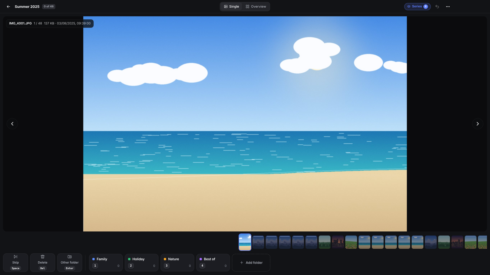
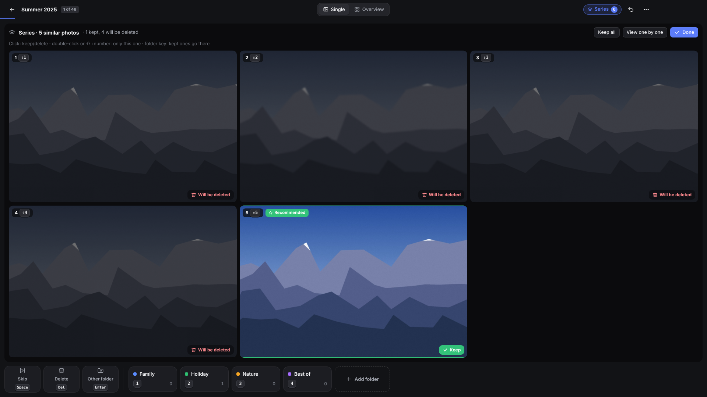

# SlimSort – free photo sorter for Windows & Mac

**Sort thousands of photos into folders with one key press per picture.**
Free · no ads · no account · works offline · never overwrites anything.

⬇️ **[Download SlimSort](https://slimbitapps.github.io/SlimSort/)** · by [SlimBit Apps](https://slimbitapps.github.io/)



## Why SlimSort?

- **One key per folder** – press 1 for Family, 2 for Holiday … the photo moves, the next one appears. About 1,000 photos in 10 minutes.
- **Safe** – never overwrites files (duplicates get a number), unlimited undo, every copy is verified before the original is removed.
- **NAS-friendly** – target folders can be on a network drive; if it goes offline, the photo simply stays where it is.
- **Burst shots** – finds series of similar photos, compares them side by side with synchronized zoom and suggests the sharpest one.
- **Real-world libraries** – tens of thousands of photos stay smooth; JPG, PNG, HEIC, WebP, TIFF, RAW (DNG, CR2, CR3, NEF, ARW, RAF, ORF, RW2) and videos; Live Photos and sidecar files (.xmp, .aae) move along.
- **Sort by date** – optional year/month subfolders per target and renaming by capture date.
- **Duplicates, search, info** – find exact duplicates, filter by name, show EXIF details (camera, lens, GPS).
- **On-device AI (optional)** – learns where you sort your photos and suggests the folder, sorts by itself on request, finds photos by description and answers questions in a chat. Three levels (Light / Balanced / Maximum) from old laptops to high-end PCs. Runs entirely on your computer; off by default.
- **Small & fast** – under 10 MB download, starts instantly (built with Tauri).
- **Private** – no telemetry, no cloud. Your photos never leave your computer.
- English, German, French, Spanish, Italian · light & dark theme · simple and expert mode.



## Install

- **Windows 10/11:** download `SlimSort-Setup.exe` and double-click it.
- **Mac (macOS 12+):** open `SlimSort-Mac.dmg` (Intel: `SlimSort-Mac-Intel.dmg`) and drag SlimSort into Applications.

The [download page](https://slimbitapps.github.io/SlimSort/) picks the right file and explains the first start step by step.

---

# SlimSort (Deutsch)

Fotos und Videos blitzschnell per Tastendruck in Ordner sortieren – für Windows und Mac (Android folgt).

**Alles bleibt lokal.** Keine Datensammlung, kein Internet nötig.

## Installieren

**Am einfachsten über die [Download-Seite](https://slimbitapps.github.io/SlimSort/)**: Sie erkennt dein System,
zeigt einen Download-Knopf und erklärt die Installation mit Bildern.

- **Windows:** `SlimSort-Setup.exe` doppelklicken. Es installiert sich ohne Fragen und startet sofort.
- **Mac:** `SlimSort-Mac.dmg` öffnen und das Symbol auf „Programme“ ziehen. Ein Pfeil im Fenster zeigt, wohin.

Wie die App ohne Warnmeldungen von Windows/macOS veröffentlicht wird: siehe **[VEROEFFENTLICHEN.md](VEROEFFENTLICHEN.md)**.

---

## So funktioniert's

Beim ersten Start führt die App durch eine kurze Einrichtung: **Sprache** (Deutsch, Englisch,
Französisch, Spanisch, Italienisch), **Aussehen** (hell, dunkel, automatisch), **Bedienung**
(Einfach oder Profi) und eine kurze bebilderte Anleitung.

1. **Ordner mit Fotos auswählen** (oder hineinziehen). Die App zeigt, wie viele Fotos und Videos darin sind.
2. **Zielordner festlegen** – neue Ordner lassen sich direkt in der App anlegen. Jeder bekommt eine Taste (1, 2, 3 …).
3. **Sortieren starten.** Beim ersten Mal erklärt eine kurze Einführung die wichtigsten Bereiche.

| Taste | Wirkung |
|---|---|
| Taste eines Zielordners | Foto (oder alle ausgewählten) dorthin |
| Leertaste | Überspringen |
| Entf / ⌫ | Löschen (in den Papierkorb der App) |
| Strg/⌘ + Z | Rückgängig – beliebig oft |
| Tab | Einzelbild ↔ Übersicht |
| F11 | Vollbild · **Esc** beendet es immer |
| F10 | Nur Bild |
| F1 | Hilfe & Tastenkürzel |
| I | Foto-Infos ein/aus (Kamera, Objektiv, Ort …) |
| Strg/⌘ + K | KI-Assistent (Chat) ein-/ausblenden |
| Rechtsklick auf ein Foto | Menü: verschieben, vergleichen, im Ordner zeigen, öffnen, löschen |
| Shift + Ordner-Taste | Ganze Serie in diesen Ordner |
| Im Vergleich: Shift + 1…6 | Nur dieses Foto behalten |
| Im Vergleich: Enter | Fertig – Behaltene bleiben, Rest in den Papierkorb |

Zuletzt verwendete Sortierungen erscheinen auf der Startseite und starten per Klick oder Taste 1–9.

---

## Sicherheit – so werden deine Fotos geschützt

- Es wird **nie etwas überschrieben**. Gibt es den Namen schon, heißt die neue Datei „Name (2).jpg“.
- Auf ein anderes Laufwerk / NAS wird **erst kopiert, dann geprüft (Prüfsumme), dann erst das Original entfernt**.
- Das **Änderungsdatum bleibt erhalten**.
- Ist ein Zielordner nicht erreichbar (z. B. NAS aus), kommt eine klare Meldung – **die Datei bleibt, wo sie ist**.
- Die App merkt selbst, wenn ein Ordner wieder erreichbar ist (nach dem Start mehrfach geprüft).
- Begleitdateien (`.xmp`, `.aae`, `.thm`) und Live-Photo-Videos wandern automatisch mit.
- „Löschen“ verschiebt nur in einen Löschordner. Endgültig weg ist erst, was du dort ausdrücklich leerst.
- Jede Dateibewegung steht im lokalen **Protokoll** (Einstellungen → Erweitert).

---

## Stand der Entwicklung

**Version 2.0** – komplett neu gebaut mit **Tauri** statt Electron: Download unter 10 MB statt über 100 MB,
startet schneller und braucht weniger Arbeitsspeicher. Neu:
- **Vergleich ohne Abdunkeln** – alle Fotos werden gleich hell gezeigt, das ausgewählte nur mit Rahmen.
- **Fotos per Maus auf einen Zielordner ziehen** (auch mehrere ausgewählte).
- **Rechtsklick-Menü** auf jedem Foto und **Info-Anzeige** (Taste I) mit Aufnahmedatum, Kamera, Objektiv, Belichtung, Ort.
- **Datums-Unterordner je Ziel** (Jahr, Jahr/Monat oder Jahr/Monat/Tag) und **Umbenennen nach Aufnahmedatum**.
- **Doppelte Fotos finden** (inhaltsgleich, per Prüfsumme) und **Suche** nach Namen in der Übersicht.
- **Weitermachen, wo du aufgehört hast**, beim erneuten Öffnen einer Sortierung.
- **Eigene Tasten** für Überspringen, Löschen und „Anderer Ordner“.
- **Aussehen anpassen**: Akzentfarbe, Hintergrund der Bildansicht, Größe der Oberfläche.
- Löschordner auf Wunsch in den **Papierkorb des Systems** leeren (wiederherstellbar).
- HEIC-Fotos werden überall angezeigt, Videos zeigen ein Standbild als Vorschau.
- Hinweis, wenn eine neue Version erscheint (abschaltbar).
- **KI (freiwillig, läuft nur auf deinem Computer):**
  - lernt, welche Fotos du in welchen Ordner tust (auch aus Fotos, die schon in den Zielordnern liegen), und schlägt den Ordner mit Sicherheit in Prozent vor
  - **KI sortieren:** zeigt, wohin sie die offenen Fotos tun würde – du bestätigst; auf Wunsch **Autopilot** für sehr sichere Fotos
  - **KI-Assistent (Chat, Strg/⌘ + K):** Fotos per Beschreibung finden („Baum links, Wiese und Berg“, „Strand im Sommer 2023“), ähnliche Fotos, verschieben/löschen per Satz, Doppelte finden, Statistik – ab Stufe „Ausgewogen“ mit Sprachmodell, das Fragen beantwortet und sich unterhält
  - **Personen (freiwillig, eigener Schalter):** erkennt Gesichter und merkt sich, wer wer ist – am Gesicht, nicht an der Position im Foto. Benennen per Klick aufs Gesicht, per Satz („ich bin links, mein Bruder daneben, Mama rechts“) oder für Unbekannte, die öfter vorkommen („Wer ist das?“). Namen im Foto, „Fotos mit Mama“, Regeln wie „Fotos mit Mama → Familie“, Personen-Übersicht (umbenennen, Gruppen, zusammenlegen). Fragt von selbst, wenn eine Person immer im selben Ordner landet
  - **Dinge merken:** „Das ist mein Auto“ oder einen Bereich im Foto markieren – die KI erkennt es auf anderen Fotos wieder (Schild im Foto, ✓/✗ zum Bestätigen), „Fotos mit meinem Auto“, Regeln „… → Ordner“, Verwaltung im Fenster „Personen & Dinge“
  - **Gedächtnis:** „Merke dir …“, „Was hast du dir gemerkt?“, „Das soll nicht mehr so sein“ – Regeln wirken auf Vorschläge, KI sortieren und Autopilot
  - **Rechte:** was die KI selbst darf (verschieben, löschen, Ordner anlegen, Einstellungen ändern, ohne Nachfrage) – mit Hinweis auf die Risiken
  - **Chats bleiben gespeichert** und lassen sich wieder öffnen; Vorschlags-Knöpfe passend zur Lage
  - **KI-Wissen sichern:** Personen, Gedächtnis, Chats und Gelerntes in eine Datei – für einen neuen Computer
  - Das Sprachmodell benutzt Werkzeuge (suchen, Personen erkennen/benennen, merken, verschieben …) und bekommt echte Ergebnisse statt zu raten
  - **drei Stufen:** *Sparsam* (CLIP, ca. 190 MB, für alte Computer), *Ausgewogen* (SigLIP 2 + Qwen3 1.7B, ca. 1,5 GB, ab 8 GB RAM), *Maximal* (SigLIP 2 Large + Qwen3 4B, ca. 3,4 GB, für starke Computer); die App empfiehlt die passende
  - in den Einstellungen komplett abschaltbar – dann läuft auch beim Start nichts; Leistung einstellbar (schonend/normal/schnell)
  - Modelle werden erst beim Einschalten einmalig von GitHub geladen; das Sprachmodell läuft in einem eigenen kleinen Helfer-Programm (llama.cpp), das nur bei Bedarf startet

**Version 1.0** – erste offizielle Version unter dem Namen SlimSort.

**Version 0.3** – Serien erkennen & vergleichen (gemeinsames Zoomen, Empfehlung des schärfsten Fotos,
Shift + Zahl / Shift + Ordner-Taste), mehrere Quellordner, Erklärungen beim Darüberfahren, aufgeräumter
Einfach-Modus, schneller und sparsamer (bildschirmgroße Vorschauen, kleinere Downloads).

**Version 0.2** – neue, einfachere Oberfläche mit Einrichtung beim ersten Start, Assistent für neue
Sortierungen, Einführung beim ersten Sortieren, Hilfe-Bereich mit häufigen Fragen, 5 Sprachen.

**Version 0.1** – enthalten:
Raster- und Einzelansicht, Zoom/Verschieben, Videos, Bildleiste, Vollbild, Nur-Bild-Modus,
Zielleiste mit Tasten/Farben/Zählern/Gruppen, Löschordner, Überspringen, „Anderer Ordner …“,
Verschieben/Kopieren, unbegrenztes Rückgängig, Filter & Reihenfolge, Profile, Schnellstart-Kacheln,
Live Photos, Zielvorschlag, Fortschritt mit Restzeit, Bilanz, NAS-Überwachung,
„Verlorene Ordner suchen“, Hell/Dunkel, Deutsch/Englisch, Hilfe-„?“.

**Als Nächstes:** Android.

---

## Für Entwickler

Technik: Tauri 2 (Rust: Fenster, Dateizugriff, Vorschaubilder), React + TypeScript (Oberfläche), Vite (Bauen).
Voraussetzungen: Node.js 22 und Rust (https://rustup.rs). Unter Linux zusätzlich die WebKitGTK-Pakete.

```bash
npm install
npm start            # App im Entwicklungsmodus starten
npm test             # Tests (Rust-Dateilogik + Oberfläche)
npm run test:e2e     # echte App automatisch durchklicken (Linux, braucht tauri-driver)
npm run dist         # Installer für das aktuelle System bauen
```

Aufbau:
- `src-tauri/src/fsops.rs` – sicheres Verschieben/Kopieren mit Prüfsumme
- `src-tauri/src/session.rs` – Warteschlange, Rückgängig, Löschordner, Protokoll
- `src-tauri/src/reach.rs` – NAS-/Laufwerks-Überwachung
- `src-tauri/src/thumbs.rs`, `protocol.rs` – Vorschaubilder und Auslieferung an die Oberfläche
- `src-tauri/src/ai/` – KI: eigene Berechnung von CLIP (Bild) und mehrsprachigem Text, Lernen, Vorschläge, Download
- `scripts/ai/` – baut die KI-Modelle (läuft auf GitHub, Workflow „KI-Modell bauen“)
- `src-llm/` – Helfer-Programm für das Sprachmodell (llama.cpp)
- `src/ai.ts`, `src/chat.ts`, `src/assistant.ts` – KI in der Oberfläche, Verstehen der Chat-Eingaben, Anleitung und Werkzeuge für das Sprachmodell
- `src/people.ts`, `src/things.ts`, `src/aimemory.ts`, `src/chats.ts`, `src/knowledge.ts` – Personen, Gedächtnis/Rechte, gespeicherte Chats, KI-Wissen sichern
- `src-tauri/src/lib.rs` – Fenster und Befehle für die Oberfläche
- `src/` – Oberfläche (React); `src/bridge.ts` verbindet sie mit Rust; Texte in `src/locales/`
- `test/` – automatische Tests

Installer werden per GitHub Actions automatisch gebaut (`.github/workflows/build.yml`).
